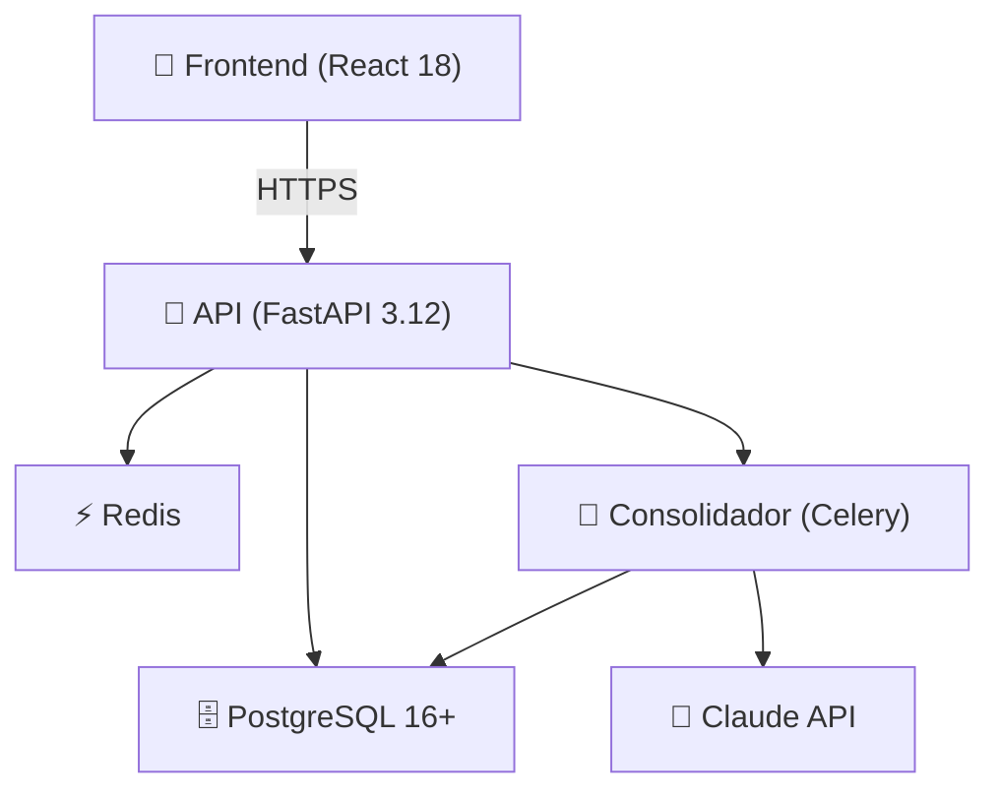

# 🧠 TESTIGO v1.0.0

> **Memoria que dura.** Tu archivo personal con inteligencia artificial.

TESTIGO es una aplicación de memoria longitudinal que acompaña a una persona durante años, registra su vida con consentimiento granular y aprende de ella. Con el tiempo, puedes conversar con tu "yo futuro" basado en una década de datos reales.

---

## 🤔 ¿Qué hago? ¿Cómo lo hago? ¿Y para qué lo hago?

**¿Qué hago:** Soy una aplicación personal de memoria longitudinal. Registro decisiones, emociones, hechos y reflexiones con consentimiento granular, consolido experiencias en creencias y patrones semánticos, y permito conversar con una versión sintetizada de ti mismo basada en datos reales.

**¿Cómo lo hago:** Cada evento que registras se almacena como texto legible cifrado AES-256. La IA consolida periódicamente tu historia en una "persona versionada" que evoluciona cada trimestre. Puedes explorar escenarios hipotéticos (tendencial, optimista, arrepentimiento) y exportar tu vida completa en JSON en cualquier momento.

**¿Para qué lo hago:** Porque nadie puede replicar 10 años de tu vida. **El valor no es la IA — el valor es la memoria.** Todo el diseño defiende ese activo: texto legible como fuente de verdad, nunca borrar (solo superponer), memoria exportable siempre.

---

## ✨ Características v1.0.0

- 📝 **Registro de eventos:** Decisiones, emociones, hechos, reflexiones, hitos vitales
- 🧠 **Memoria semántica:** Consolidación de experiencias en creencias y patrones
- 💬 **Conversación con tu yo:** Habla con una versión sintetizada de ti mismo
- 👤 **Persona versionada:** Tu "snapshot" evoluciona cada trimestre
- 🔮 **Yo futuro:** Explora escenarios: tendencial, optimista, arrepentimiento
- 📤 **Export completo:** Descarga tu historia en JSON legible
- 🔐 **Privacidad radical:** Cifrado AES-256, consentimiento granular, sin dependencias de proveedor
- ⚙️ **Auto-versionado:** La IA mejora, tu memoria sobrevive

---

## 🚀 Instalación rápida

### Requisitos
- Docker + Docker Compose
- (Opcional: Python 3.12, Node.js 20 para desarrollo sin contenedores)
- API key de Anthropic (Claude) para conversaciones

### Pasos

```bash
# Clonar
git clone https://github.com/yourusername/testigo.git
cd testigo

# Configurar
cp .env.example .env
nano .env                          # Editar con ANTHROPIC_API_KEY

# Iniciar
docker-compose up
```

### URLs

| URL | Servicio |
|---|---|
| http://localhost:8000 | API REST (FastAPI) |
| http://localhost:3000 | Frontend (React) |
| http://localhost:8000/docs | Docs interactiva |

### Usuarios de prueba (demo)

```
Sophia García (sophia@testigo.local)
Marcus Chen (marcus@testigo.local)
Elena Rodriguez (elena@testigo.local)
```

Token automático en modo demo.

---

## 🏗️ Arquitectura



**Stack:**
- 🎨 **Frontend:** React 18 + Tailwind + TypeScript
- 📡 **API:** FastAPI + Python 3.12
- 🗄️ **Base de datos:** PostgreSQL 16+
- ⚡ **Job queue:** Celery + Redis
- 🧠 **LLM:** Claude Anthropic (intercambiable)

---

## 🔑 Principios (No Negociables)

1. **La memoria sobrevive al modelo.** El modelo es intercambiable cada 2-4 años. La memoria vive 20+.
2. **Texto legible = fuente de verdad.** Todo hecho se guarda como texto. Embeddings son derivados regenerables.
3. **Nunca borrar, solo superponer.** La gente cambia. Archiva la contradicción como historia.
4. **Consentimiento viaja con el dato.** Cada evento tiene su propio nivel de permiso, revocable.
5. **Exportable siempre.** Sin costo, sin fricción, sin caducidad. Es un derecho.
6. **La IA propone, el humano dispone.** Ninguna funcionalidad autogenerada sin aprobación.
7. **La empresa puede morir, la memoria no.** El esquema permite reconstruir sin infraestructura original.

---

## 📚 Documentación

| Doc | Contenido |
|---|---|
| [🚀 Instalación](docs/INSTALACION.md) | Setup detallado, desarrollo local, troubleshooting |
| [🏗️ Arquitectura](docs/ARQUITECTURA.md) | Diseño técnico, flujos, decisiones de diseño |
| [📡 API](docs/API.md) | Endpoints, esquemas, ejemplos de uso |
| [📝 Cambios](docs/CAMBIOS.md) | Historial v1.0.0 → futuras releases |

---

## 🛠️ Desarrollo

### Backend
```bash
python -m venv venv
source venv/bin/activate
pip install -r requirements.txt
python main.py
```

### Frontend
```bash
cd web
npm install
npm run dev
```

### Tests
```bash
pytest tests/ --cov=api,core --cov-report=html
```

---

## 🔐 Seguridad y Privacidad

✅ Cifrado AES-256 en reposo
✅ TLS 1.3 en tránsito
✅ Consentimiento granular por evento
✅ Revocación sin borrado (auditoría preservada)
✅ Menor privilegio: consolidador read-only en eventos
✅ GDPR-first: portabilidad como principio

---

## 🤝 Contribuciones

Este proyecto fue desarrollado con IA desde cero en una sesión. Las contribuciones son bienvenidas:

1. Fork el repo
2. Rama para tu feature: `git checkout -b feature/amazing`
3. Commit: `git commit -m "Add amazing feature"`
4. Push: `git push origin feature/amazing`
5. Abre Pull Request

### Contacto

- 🐛 [Issues](https://github.com/yourusername/testigo/issues)
- 💬 [Discusiones](https://github.com/yourusername/testigo/discussions)
- 📧 hola@testigo.local

---

## 📊 Status v1.0.0

| Componente | Status | Nota |
|---|---|---|
| 📝 Ingest de eventos | ✅ v1.0 | Producción |
| 🧠 Memoria semántica | ✅ v1.0 | Producción |
| 🔄 Consolidador | ✅ v1.0 | Cron diaria (no Celery distribuida aún) |
| 👤 Persona versionada | ✅ v1.0 | Trimestral manual por ahora |
| 💬 Conversación | ✅ v1.0 | Inyección de memoria, sin streaming avanzado |
| 📤 Export | ✅ v1.0 | JSON completo, legible |
| 🎨 Frontend | ✅ v1.0 | React completo, hermoso |
| 🧪 Tests | ✅ v1.0 | Cobertura crítica >90% |
| 🔌 Extensiones | 📋 v1.1 | Diseño completado, implementación pendiente |

---

## 🎓 Créditos

Diseñado e implementado 100% por Claude (Anthropic) en una sesión usando esta guía:
- Visión y especificación técnica: usuario
- Implementación, testing, documentación: Claude
- Principios inspirados en sistemas de memoria personal

---

## 📄 Licencia

**[MIT](LICENSE)** — Libre para uso comercial, modificación y distribución.

© 2026 TESTIGO Contributors

```
Licensed under MIT License
```

---

**TESTIGO v1.0.0 está listo para producción.** Tu historia te espera. 🧠
